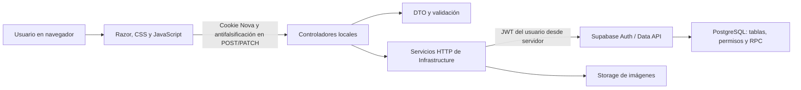

# Relación del caso de estudio con Comercial Nova

**Actualización del dashboard (2026-11-27):** implementados indicadores y consulta administrativa de ventas con un tour voluntario. [Dashboard: alcance y evidencia](Dashboard.md). Las referencias posteriores a una bienvenida simple pertenecen a la revisión histórica inicial; la edición simultánea y la prueba concurrente siguen pendientes.

Revisión documental y de código: 2026-11-26. Complemento: [guion de sustentación](Defensa_del_proyecto.md).

**Actualización 2026-11-27:** [resolución práctica de los seis puntos](Resolucion_casos.md). Confirmada la actualización condicional de stock en el RPC real, añadidos toasts y mensajes específicos, y aprobados seis casos SQL con rollback y seis escenarios de interfaz simulada. Esas dos pruebas focalizadas ahora están versionadas. Los estados de la revisión del 26 de noviembre que siguen debajo son históricos; siguen pendientes concurrencia real y control de versiones en edición.

## Fuente, alcance y conclusión

Fuente académica: **CASO DE ESTUDIO PROYECTO FINAL.pdf**, proporcionado por el usuario desde Descargas; cuatro páginas, título del caso «Una empresa que creció más rápido que su tecnología». Las páginas citadas corresponden al orden físico del PDF. No se copia el archivo al repositorio; conservar el original para la entrega académica según las indicaciones del docente.

El documento pide diagnóstico, propuesta técnica, prototipo y sustentación. En la sección 5.4 (p. 2) exige resolver **al menos un problema crítico**, mostrando recorrido de datos, validaciones y una operación válida e inválida. No exige reconstruir todo el sistema empresarial ni prescribe un lenguaje concreto.

Nova tiene una base coherente para defender **el registro de ventas con control de existencias y recuperación de operaciones**. Sin embargo, la integración escrita y las pruebas simuladas no equivalen a una prueba concurrente real del RPC. La protección frente a sobrescrituras simultáneas al editar productos sigue pendiente. No corresponde presentar los seis problemas como completamente resueltos.

Esta revisión no modificó código funcional, API, esquema ni datos de Supabase; tampoco publicó cambios en GitHub. Las indicaciones del PDF se usan como criterios de análisis, no como autorización para ejecutar escrituras o publicar.

## Diagnóstico y matriz de cobertura

El caso describe síntomas, no aporta el código del sistema original. Las causas siguientes son hipótesis de ingeniería; el prototipo muestra cómo abordarlas, no demuestra que fueran las causas históricas.

| Problema del caso (p. 1, sección 3) | Causa probable y riesgo | Respuesta actual y evidencia | Límite y siguiente comprobación |
| --- | --- | --- | --- |
| 1. Ventas sin existencias suficientes | Comprobar stock solo en pantalla o separar lectura y descuento permite usar datos desactualizados. Riesgo de sobreventa. | `/Ventas` valida en servidor y confirma por `register_sale`; el navegador no fija precios ni vendedor. [Controlador](../Controllers/VentasController.cs), [servicio](../Infrastructure/SupabaseVentasService.cs) y [contrato](Ventas.md). | La validación previa no reserva stock. El contrato documenta descuento y registro transaccionales. Pendiente ensayo real simultáneo y conservación de evidencias. |
| 2. Dos empleados modifican el mismo producto | Dos formularios cargan una versión antigua; el último guardado puede sobrescribir al primero. Riesgo de pérdida de cambios comerciales. | El editor excluye SKU y stock; las existencias usan RPC. [Servicio de catálogo](../Infrastructure/SupabaseCatalogoService.cs), método `GuardarAsync`. | **Pendiente para nombre, precio y otros campos**: PATCH filtra solo por ID, sin versión esperada. RLS controla quién escribe, no detecta edición obsoleta. Proponer control optimista de versión y conflicto visible. |
| 3. Un cambio rompe otras funciones | Acoplamiento entre interfaz, reglas e integración, junto con comprobaciones insuficientes. | Controladores, DTO, servicios HTTP, modelos y componentes compartidos separan responsabilidades. Se documentan comprobaciones aisladas por módulo. | No se identificó una suite de pruebas versionada ni CI. La separación reduce el impacto, pero no garantiza ausencia de regresiones. |
| 4. Muchas pantallas para una operación sencilla | Flujo fragmentado y retroalimentación insuficiente. | Venta con catálogo y carrito juntos; alta/edición/stock en diálogos; búsqueda, skeletons, errores recuperables. [Ventas](Ventas.md), [Productos](Productos.md). | Falta medir el recorrido con usuarios y revisar visualmente en navegador. Animaciones y estilo no prueban por sí solos usabilidad. |
| 5. Un nuevo equipo no comprende el código | Responsabilidades y contratos implícitos; pérdida de conocimiento. | [agents.md](../agents.md), [README](../README.md), guías por módulo y [Postman](Comercial_Nova.postman_collection.json) explican rutas, permisos y pendientes. | Requiere mantenimiento continuo y comprobar el arranque en otra máquina. No todos los objetos remotos tienen su definición SQL completa versionada. |
| 6. Consulta futura desde móviles | Interfaz dependiente de escritorio y acceso a datos ligado a la vista. | CSS responsive, tarjetas, drawer y APIs JSON. [Ventas CSS](../wwwroot/css/ventas.css), [Productos CSS](../wwwroot/css/productos.css), [navegación](../wwwroot/js/workspace.js). | Es web responsive, no aplicación móvil nativa ni modo offline. Pendientes pruebas táctiles y adaptación de autenticación si se crea otro cliente. |

Prioridad propuesta para la exposición: integridad de ventas, explicación del recorrido de datos y demostración válida/inválida. Después, mostrar mantenibilidad y adaptación móvil. Reconocer explícitamente la brecha de edición concurrente.

## Arquitectura y conceptos del curso

Responde a la sección 5.2 (p. 2). Existe **un solo proyecto ASP.NET Core 10**, con MVC y Razor Pages; no son dos aplicaciones frontend/backend independientes ni microservicios.

| Concepto | Ejemplo real | Explicación para la defensa |
| --- | --- | --- |
| Abstracción | `SupabaseVentasService.ValidarAsync` y `RegistrarAsync` | El controlador solicita una operación sin construir cada llamada HTTP ni interpretar toda la respuesta externa. |
| Encapsulación | Método privado genérico `EnviarAsync<T>` del servicio | Centraliza autenticación HTTP, envío y traducción de errores; el navegador no recibe el JWT. |
| Clases y objetos | `VentaItemInput`, `Producto`, `VentaRegistrada` | Representan datos y contratos. `Producto.Estado` calcula una clasificación a partir del modelo. |
| Herencia | `RegistrarVentaInput : ValidarVentaInput`; `ProductosController : CatalogoControllerBase` | Reutiliza contrato del pedido y manejo común del catálogo. No hace falta inventar jerarquías de entidades. |
| Interfaces y polimorfismo | `IValidatableObject` en `ValidarVentaInput`; `IHttpClientFactory` inyectado | ASP.NET utiliza contratos para validar y construir clientes HTTP. No se implementó una arquitectura de plugins de negocio. |
| Inyección de dependencias | Registro de servicios en [Program.cs](../Program.cs) | El framework construye controladores y servicios con sus dependencias; evita crearlos manualmente en cada acción. |
| MVC y Razor Pages | `Views/Login`, `Pages/Ventas`, controladores API y modelos/DTO | La presentación genera la interfaz; los controladores reciben solicitudes; modelos y servicios representan datos y operaciones. Es una combinación de ambos mecanismos de ASP.NET. |
| Cliente-servidor | Navegador → Nova → Supabase | Las validaciones visuales ayudan al usuario; autorización e integridad se vuelven a comprobar en servidor/base de datos. |

No afirmar que todas las reglas están en C#: validaciones de entrada están en DTO/servicios, y las operaciones transaccionales de existencias pertenecen a PostgreSQL mediante RPC. Eso es una distribución deliberada de responsabilidades.

### Datos y recorrido de una venta

Entidades relevantes: `products` con `brands` y `categories`; `customers`; `profiles` vinculado por UUID con Supabase Auth; `sales`, `sale_details` y `stock_movements`. La imagen del producto es una referencia a un objeto de Storage; no reemplaza el registro del catálogo.

1. El navegador consulta `GET /api/ventas/productos` y construye el carrito.
2. Envía IDs y cantidades a `POST /api/ventas/validar`; Nova consulta productos y cliente y calcula importes con los precios consultados. No escribe ni reserva.
3. Guarda un UUID y el pedido pendiente por usuario en `sessionStorage` y envía `POST /api/ventas` con antifalsificación. No guarda el JWT allí.
4. El servicio transmite `p_request_id`, `p_customer_id` y `p_items` al RPC `register_sale`, usando la identidad autenticada. El contrato documenta precios de base, descuento de stock y escritura de venta/detalles/movimientos dentro de una transacción.
5. Con éxito muestra ID y total confirmados. Ante respuesta incierta conserva UUID y cuerpo exactos; el reintento busca recuperar esa operación, no crear otra.

**Atomicidad, concurrencia e idempotencia son propiedades distintas.** La transacción agrupa escrituras; el control concurrente debe impedir que dos ventas consuman la misma unidad; el UUID identifica reintentos del mismo pedido. Un bloqueo por UUID no demuestra por sí solo protección entre ventas con UUID distintos. Consultar la implementación efectiva del RPC y ensayarla antes de afirmar que veinte vendedores están cubiertos.

## Comparación de tecnologías

Responde a la sección 5.3 (p. 2). Comparación conceptual para este prototipo; no constituye un benchmark ni una cotización de proveedores.

| Criterio | A. ASP.NET Core MVC/Razor + PostgreSQL gestionado (actual) | B. React + API Node.js/TypeScript + PostgreSQL |
| --- | --- | --- |
| Complejidad inicial | Un proyecto web; render del servidor y JavaScript para interacciones puntuales. | Frontend y API con herramientas, contratos y compilaciones que deben coordinarse. |
| Mantenimiento | Tipado de C#, DTO, inyección y estructura conocida de ASP.NET; conviven Razor Pages y MVC y deben documentarse. | TypeScript compartido como lenguaje; necesita disciplina equivalente para validación en ejecución y separación de capas. |
| Crecimiento | APIs reutilizables; se puede optimizar paginación e independizar partes si aparece una necesidad medida. | Facilita una interfaz SPA compleja y clientes separados; no aporta por sí misma mayor integridad de datos. |
| Datos e integridad | PostgreSQL concentra operaciones transaccionales; Supabase aporta servicios gestionados que requieren configurar permisos. | Puede usar el mismo PostgreSQL y los mismos principios transaccionales. Node.js no sustituye esos controles. |
| Necesidad del caso | Adecuado para un equipo que necesita demostrar catálogo, venta y validación en un prototipo acotado. | Alternativa válida si el equipo domina React/Node y necesita una SPA; añade coordinación que aquí no es indispensable. |

Se justifica A por el alcance actual, el tipado, la organización de responsabilidades y la posibilidad de demostrar el flujo con un solo despliegue web. No porque B sea insegura o incapaz de manejar concurrencia. Otra decisión separada es usar servicios gestionados en vez de operar PostgreSQL, autenticación y archivos por cuenta propia: simplifica operación inicial a cambio de dependencia de red/proveedor y de sus límites. Los costos y cuotas vigentes deben consultarse antes de contratar; ver [Storage](Storage.md).

## Evaluación y entregables

Las semanas del PDF son **3 a 7**, aunque se describe una duración de cinco semanas (p. 3). La tabla organiza la entrega actual; no certifica que el equipo haya cumplido ese calendario histórico.

| Semana / criterio | Peso | Material para presentar |
| --- | --- | --- |
| 3. Diagnóstico | 20 | Matriz de problemas, hipótesis, riesgos y prioridad de este documento. |
| 4. Diseño y conceptos | 25 | Arquitectura, responsabilidades y ejemplos concretos de clases/contratos. |
| 5. Tecnologías | 20 | Comparación A/B, justificación, límites y condiciones de implementación. |
| 6. Prototipo y pruebas | 20 | Demo válida/inválida, registros verificables y contraste entre pruebas simuladas y reales. |
| 7. Sustentación | 15 | [Guion, preguntas del PDF y plan de demostración](Defensa_del_proyecto.md). |

No se asigna una nota al proyecto: corresponde al docente evaluar la evidencia presentada.

## Evidencia disponible y pendientes antes de la entrega

**Verificado en esta revisión:** lectura del texto completo de las cuatro páginas; inspección de `Program.cs`, controladores, servicios, DTO, modelo y reglas responsive; confirmación de que el PATCH de productos filtra solo por ID. `appsettings.Local.json` está ignorado y no aparece entre los archivos versionados. Esto último no constituye una auditoría completa del historial de Git.

**Evidencia histórica documentada:** [Ventas](Ventas.md) registra 24 casos POST con Supabase/autenticación simulados y lectura previa del contrato remoto; [Productos](Productos.md), [Vendedores](Vendedores.md), [Sesión](Sesion.md) y [Storage](Storage.md) registran sus comprobaciones. No sumar esos conteos como una suite única: proceden de entregas y entornos distintos. Los hosts temporales de prueba no están versionados, por lo que esas guías describen verificaciones históricas y no una suite reproducible desde un checkout limpio.

**Sin ejecutar aquí:** aplicación, pruebas de venta, escrituras remotas, carga concurrente o inspección visual del PDF/sitio. La extracción permitió revisar el contenido textual; no se contó con renderizador PDF. Esta entrega es exclusivamente documental y no requiere recompilar.

**Comprobaciones documentales de cierre:** 29 enlaces locales de las dos guías resuelven a archivos existentes; colección Postman parseada como JSON válido; `git diff --check` sin errores de formato (aviso de conversión LF/CRLF en un JavaScript previamente modificado). No se modificó la colección por esta revisión.

Pendientes priorizados:

1. Ensayar venta válida e inválida con cuentas autorizadas y productos de prueba; guardar evidencia de petición/respuesta sin cookies, JWT ni claves.
2. Ensayar veinte ventas concurrentes de una unidad disponible, con UUID distintos, verificando stock, ventas, detalles y movimientos. Mantenerlo marcado pendiente hasta tener resultados.
3. Implementar posteriormente versión esperada en edición de producto, con operación condicional atómica y conflicto recuperable; no está incorporado en esta entrega.
4. Versionar pruebas reproducibles y las definiciones necesarias del backend remoto, revisar el arranque desde un checkout limpio y validar móvil con navegador real.
5. Revisar el diff antes del commit: existen cambios previos de sesión, vendedores e historia. Incluir archivos nuevos necesarios, excluir configuración local y comprobar enlaces. No se ejecutó commit ni push.

El Dashboard sigue siendo una bienvenida; no presentar gráficos de ventas como implementados. La consulta de clientes para venta no es un CRUD completo de clientes. No hay cobro bancario, factura fiscal ni aplicación móvil nativa. La creación de credenciales de vendedores requiere la clave Auth Admin del servidor, cuya ausencia local está documentada en [Vendedores](Vendedores.md). Estos límites no invalidan el alcance mínimo del caso, pero deben explicarse.
