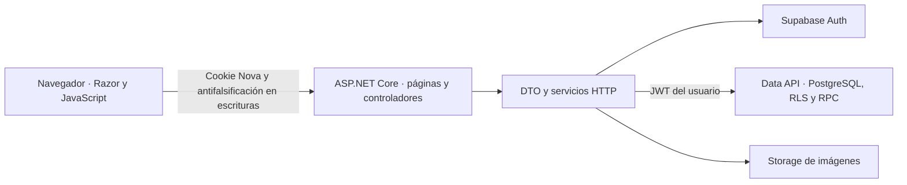

# Guía técnica para defender Comercial Nova

Revisión del 27 de noviembre de 2026. Basada en el código del repositorio y en el PDF **CASO DE ESTUDIO PROYECTO FINAL**, titulado «Una empresa que creció más rápido que su tecnología». Las páginas corresponden al orden del PDF original. Para el guion completo y las evidencias previas, consultar [Defensa del proyecto](Defensa_del_proyecto.md) y [Resolución de los seis casos](Resolucion_casos.md).

## Qué pide el enunciado

La sección 5.4 (p. 2) pide un prototipo que resuelva al menos un problema crítico y muestre el recorrido de los datos, sus validaciones y una operación válida e inválida. El caso de demostración de Nova es **vender con control de existencias**, correspondiente al problema 1 de la sección 3 (p. 1).

| Referencia del PDF | Qué presentar de Nova |
| --- | --- |
| §3.1–3.2 y §5.1 (pp. 1–2) | Riesgo de sobreventa por stock desactualizado y riesgo de sobrescritura al editar. La venta tiene protección transaccional. La edición comercial aún guarda por ID, sin versión esperada. |
| §3.3, §3.5 y §5.2 (pp. 1–2) | Responsabilidades de Razor, controladores, DTO, servicios y base de datos. Mostrar un ejemplo de herencia y uno de abstracción, con código y documentación para el siguiente equipo. |
| §3.4 y §3.6 (p. 1) | Catálogo y carrito en una pantalla, acciones en diálogos y diseño web responsive. |
| §5.3 y §5.5 (p. 2) | Comparación de stacks y alternativas de persistencia, ventajas, costos de operación y límites. |
| §5.4, §7 y §8 (pp. 2–3) | Demo válida e inválida, pruebas disponibles y explicación de lo que aún falta verificar. |
| §8.1 (pp. 3–4) | Preguntas sobre veinte vendedores, MVC, presupuesto y un futuro cliente móvil. |

## Cómo se organiza el proyecto

Nova es un proyecto C# con ASP.NET Core 10. MVC sirve la vista de login y expone las APIs locales. Razor Pages genera las pantallas del área de trabajo. JavaScript consulta esas APIs y actualiza el HTML. Los controladores reciben y coordinan las solicitudes. Los DTO describen qué datos se aceptan y qué se devuelve. Los servicios de `Infrastructure/` encapsulan las llamadas HTTP a Supabase Auth, Data API y Storage. PostgreSQL ejecuta consultas, restricciones y funciones de base de datos invocadas por RPC.

**Ejemplos para §5.2.** `ProductosController` hereda de `CatalogoControllerBase` y reutiliza el manejo de errores. `RegistrarVentaInput` extiende el contrato de prevalidación con un UUID. `VentasController` pide al servicio validar o registrar sin construir la solicitud a Supabase. El framework proporciona ese servicio por inyección de dependencias. [Configuración de la aplicación](../Program.cs) · [Contrato de venta](../Dtos/VentaDto.cs)

## Qué hace cada controlador

Las rutas de esta tabla pertenecen al servidor Nova. Los RPC mencionados se invocan desde los servicios. Los controladores de API requieren sesión y las escrituras incluyen antifalsificación.

| Controlador | Ruta local y responsabilidad | Dónde aplica las comprobaciones |
| --- | --- | --- |
| [LoginController](../Controllers/LoginController.cs) | `GET /Login` o `/` muestra el formulario o redirige una sesión existente. `POST /Login` autentica y emite la cookie. `POST /Login/Salir` cierra la sesión local. | `ModelState` con `LoginInput`, credenciales en Supabase Auth, usuario y expiración del token en el controlador, perfil comercial activo consultado por el servicio de personal. |
| [SesionController](../Controllers/SesionController.cs) | `GET /api/sesion` devuelve perfil propio y tiempos. `POST /api/sesion/actividad` actualiza la última actividad. | GET comprueba identidad, token, perfil y vigencia. POST comprueba la sesión local y conserva el vencimiento absoluto. |
| [DashboardController](../Controllers/DashboardController.cs) | `GET /api/dashboard` carga indicadores y ventas. `GET /api/dashboard/ventas/{id}` devuelve el detalle. | Rol admin en el controlador, periodo, página e ID en las acciones. Los RPC comprueban perfil admin activo y se ejecutan respetando RLS. |
| [ProductosController](../Controllers/ProductosController.cs) | `GET /api/productos` lista. `POST /api/productos` crea. `PATCH /api/productos/{id}` edita. `POST /api/productos/{id}/stock` registra un ingreso. | Parámetros, ID y motivo en el controlador. Datos del formulario en DTO. Permisos y restricciones en PostgreSQL. El ingreso usa `adjust_stock`. |
| [ProductosFiltroController](../Controllers/ProductosFiltroController.cs) | `GET /api/productos/filtros` devuelve marcas y categorías. `activos=true` se usa en formularios. | El framework convierte el parámetro booleano. El servicio aplica el filtro y consulta con el JWT del usuario. |
| [ProductosKpiController](../Controllers/ProductosKpiController.cs) | `GET /api/productos/kpi` calcula indicadores globales con productos activos. | Sesión y acceso a los datos. La clasificación de inventario se calcula en C# y es independiente de los filtros de la tabla. |
| [ProductoDetalleController](../Controllers/ProductoDetalleController.cs) | `GET /api/productos/{id}` devuelve el producto para consultar o editar. | La ruta exige ID numérico. Si la consulta con la identidad del usuario no devuelve el producto, responde 404. |
| [ProductoImagenController](../Controllers/ProductoImagenController.cs) | `POST /api/productos/imagen` recibe un archivo y devuelve la URL pública confirmada. | Límite de solicitud multipart en el controlador, tamaño y formato comprobados en el servicio, permiso de carga en las políticas de Storage. |
| [ProductoTrazabilidadController](../Controllers/ProductoTrazabilidadController.cs) | `GET /api/productos/{id}/trazabilidad` devuelve alta e historial paginado de movimientos relacionados con ventas. | ID positivo, cursor opcional positivo y perfil admin activo. Devuelve 404 si el producto no está disponible. |
| [VentasController](../Controllers/VentasController.cs) | `GET /api/ventas/productos` y `GET /api/ventas/clientes` abastecen los selectores. `POST /api/ventas/validar` previsualiza el pedido. `POST /api/ventas` registra mediante `register_sale`. | Parámetros y UUID en el controlador, estructura del pedido en DTO, disponibilidad previa en el servicio y decisión final en PostgreSQL. |
| [VendedoresController](../Controllers/VendedoresController.cs) | En `/api/vendedores`, GET lista y POST vincula una cuenta Auth existente. GET y PATCH `/{id}` consultan y editan el perfil seller. GET `/{id}/comprobantes` lista comprobantes. POST `/alta`, PATCH `/{id}/cuenta` y POST `/{id}/clave` gestionan cuentas. | Rol admin, comprobaciones de perfil activo en acciones y en políticas/RPC, UUID y cursor, DTO de cuenta, bloqueo de cambios de cuenta propia y disponibilidad de Auth Admin para operaciones de credenciales. |
| [CatalogoControllerBase](../Controllers/CatalogoControllerBase.cs) | Clase abstracta sin ruta pública propia. Comparte comportamiento entre APIs de catálogo, dashboard, vendedores y sesión. | Atributos de sesión y API, respuestas sin caché y traducción común de errores de Supabase o conectividad. |

El [PageModel del dashboard](../Pages/Index.cshtml.cs) comprueba también que el administrador siga activo antes de renderizar `/Bienvenida`. El catálogo de Nova consulta tablas y calcula sus indicadores en C#. La vista `vw_product_catalog` y el RPC `get_inventory_summary` están documentados en Supabase y su consumo por Nova sigue pendiente. [Contrato de Productos](Productos.md)

## Pantallas y flujo de uso

| Pantalla | Flujo | Qué ilustra en el PDF |
| --- | --- | --- |
| [Inicio de sesión](../Views/Login/Index.cshtml) · `/`, `/Login` | Introducir correo y contraseña → validar credenciales y perfil → emitir cookie → administrador a `/Bienvenida`, vendedor a `/Ventas`. Ante error se vuelve al formulario con un mensaje. | §5.2, identidad y comunicación cliente-servidor. §5.4, ejemplo de rechazo de acceso. |
| [Dashboard](../Pages/Index.cshtml) · `/Bienvenida` | El admin entra → carga indicadores, gráfico de siete días, ranking y ventas → elige hoy, semana o mes → pagina ventas → abre detalle en un diálogo. Un fallo muestra estado recuperable y KPI sin valor disponible. | §5.2, consultas separadas de la vista. §3.4, consulta y detalle en el mismo contexto. |
| [Ventas](../Pages/Ventas.cshtml) · `/Ventas` | Buscar por nombre/SKU o filtrar por categoría → agregar productos al carrito → ajustar cantidades y elegir cliente opcional → validar → revisar precios e importes → confirmar → ver ID y total. Cambiar el carrito o el cliente invalida la revisión. Una respuesta incierta permite recuperar el mismo pedido. | §3.1 y §5.4, demostración principal. §3.4 y §3.6, flujo corto y responsive. |
| [Productos](../Pages/Productos.cshtml) · `/Productos` | Cargar KPI, filtros y tabla → buscar y paginar → ver detalle. El admin puede crear o editar en el mismo diálogo, adjuntar una imagen, registrar un ingreso o consultar trazabilidad. Tras un guardado confirmado, se actualizan tabla e indicadores. | §3.2, mostrar el alcance de la edición. §3.4, acciones sin salir de la tabla. §5.4, inventario y trazabilidad como evidencia complementaria. |
| [Vendedores](../Pages/Vendedores.cshtml) · `/Vendedores` | El admin revisa métricas y directorio → filtra personas → vincula un usuario Auth mediante UUID o edita datos básicos y estado de un seller → abre una ficha para gestionar la cuenta. | §5.2, separación de identidad, perfil y rol. §3.4, acciones desde el directorio. |
| [Ficha de vendedor](../Pages/VendedorFicha.cshtml) · `/Vendedores/Nuevo` y `/Vendedores/Editar/{id}` | Alta: completar datos, rol, estado y credenciales → enviar un UUID de operación → crear cuenta y confirmar perfil. Edición: cargar ficha → actualizar perfil/correo o cambiar contraseña por separado → desplegar comprobantes paginados. La ruta inválida muestra 404. | §5.2 y §5.4, permisos y validaciones de cuenta como evidencia complementaria. |
| [Nuestra historia](../Pages/NuestraHistoria.cshtml) · `/NuestraHistoria` | Abrir desde el menú → recorrer las cuatro etapas ficticias y navegar por año. Contenido de lectura con sesión. | §3.6, ejemplo secundario de adaptación visual. La demostración de integridad se hace en Ventas. |
| [Página 404](../Pages/NotFound.cshtml) · `/404` | Una ruta web GET/HEAD sin coincidencia muestra una pantalla de recuperación con estado HTTP 404. | §3.4, retroalimentación ante navegación inválida. |

La cabecera compartida abre el panel de cuenta y ofrece el tour voluntario. La sesión avisa a los 120 segundos de inactividad y se cierra a los 180. La cookie tiene un máximo absoluto de 60 minutos o vence antes si vence el token. Registrar actividad conserva ese límite. [Sesión](Sesion.md) · [Dashboard y recorrido](Dashboard.md)

## Validaciones, ubicación y relación con la defensa

La interfaz da retroalimentación inmediata. ASP.NET valida el contrato antes de ejecutar las acciones de API. Los servicios comprueban datos consultados y la base aplica permisos y reglas de escritura. El PDF plantea problemas y criterios de demostración. Las reglas concretas de campos, tamaños y seguridad son decisiones del prototipo.

| Validación | Dónde ocurre y qué sucede si falla | Relación con el PDF |
| --- | --- | --- |
| Correo y contraseña de inicio | `LoginInput` exige correo válido de hasta 254 caracteres y contraseña obligatoria de hasta 1.024. `LoginController` revisa `ModelState`, entrega credenciales a Auth y comprueba usuario, token vigente y perfil activo admin/seller. Si falla, vuelve al formulario sin crear sesión. | §5.2, autenticación y autorización separadas. §5.4, recorrido válido e inválido. |
| Sesión, rol y antifalsificación | `Program.cs`, `NovaSessionPolicy`, atributos ASP.NET y políticas/RPC remotos. Una API protegida devuelve 401 sin sesión y 403 ante falta de permiso explícita. Las escrituras requieren token antifalsificación. RLS aplica las políticas de acceso por fila con identidad del usuario. | §5.2, responsabilidades cliente-servidor. §5.5, condiciones de implementación. |
| Consultas del catálogo y venta | `ProductosController` verifica búsqueda de hasta 120 caracteres, página positiva, tamaño de 1 a 100 y estado permitido. `VentasController` verifica los 120 caracteres, página de 1 a 1.000.000 y categoría positiva si viene informada. GET de clientes limita el texto a 120. ASP.NET convierte los tipos de ruta y consulta. | §3.3 y §5.2, contratos en el servidor. §3.4, búsqueda y paginación. |
| Cantidades y estructura del pedido | `ventas.js` bloquea cantidades no enteras, inferiores a uno o superiores al stock mostrado. `VentaDto` exige de 1 a 100 líneas, sin artículos nulos o duplicados, IDs y cantidades positivos y cliente opcional positivo. El controlador exige UUID válido y no vacío para registrar. Un cuerpo inválido se rechaza con 400. | §3.1 y §5.4, evitar ventas inválidas desde el carrito y la API. |
| Cliente, producto, precio y stock al validar | `SupabaseVentasService.ValidarAsync` comprueba que el cliente siga disponible si fue elegido y que cada producto exista, esté activo y tenga stock. Calcula importes con precios consultados. El controlador comunica 409 con errores cuando el pedido no es viable. La prevalidación es de lectura y el stock sigue disponible para otras ventas. | §3.1 y §5.4, mostrar el recorrido y el error antes de confirmar. |
| Stock final, reversión e idempotencia | `register_sale` comprueba el perfil y vuelve a decidir con el stock real. El descuento condicional exige producto activo y `stock >= cantidad`. Si falla una línea por existencias, rechaza con 409 y revierte todos los cambios, incluidos descuentos previos del mismo pedido. El mismo UUID con el mismo pedido recupera el resultado. Reutilizarlo para otro pedido genera conflicto. Ante respuesta incierta, `ventas.js` conserva el UUID y el cuerpo exacto para reintento manual. | §3.1, §5.4 y §8.1 pregunta 1. El descuento protege pedidos distintos y el UUID identifica reintentos. |
| Alta y edición de producto | `CrearProductoInput` valida nombre de 3 a 200 caracteres, SKU obligatorio de hasta 80 en el contrato compartido, marca y categoría positivas, precio de 0,01 a 9.999.999.999,99 con dos decimales como máximo, mínimo no negativo, descripción de hasta 250 e imagen de hasta 2.048 caracteres con HTTPS o ruta local absoluta válida. PostgreSQL aplica relaciones, restricciones y unicidad de SKU. El servicio excluye SKU y stock del PATCH, y el alta deja stock inicial en cero. | §3.2 y §5.2, separar cambios comerciales y de inventario. Falta controlar versiones para detectar ediciones obsoletas. |
| Imagen del catálogo | `producto-form.js` verifica archivo y URL para la vista previa. `ProductoImagenController` limita la solicitud a 6 MiB. `SupabaseStorageService` verifica tamaño del archivo mayor que cero y hasta 5 MiB, tipo y firma JPEG/PNG/WebP. Storage limita la subida al administrador activo en su carpeta asignada. | §5.2 y §5.5, separación de archivos y datos, y límites de la integración. |
| Ingreso de existencias | `StockEntradaInput` requiere cantidad entera positiva y limita punto de ingreso a 100 caracteres y observaciones a 250. `ProductosController` exige ID positivo y motivo de la lista permitida. `adjust_stock` aplica permiso de admin activo, aumenta stock y registra el movimiento en una transacción. Un producto no disponible o un desbordamiento se comunica como 409. | §3.1 y §5.4, consistencia del inventario y evidencia en trazabilidad. |
| Dashboard, detalle y trazabilidad | Dashboard exige admin, periodo hoy/semana/mes, página de 1 a 100.000 e ID de venta positivo. Página y RPC verifican perfil activo. Trazabilidad exige admin activo, ID y cursor positivos. Los detalles ausentes responden 404. | §5.2, permisos y parámetros de lectura. §3.4, mensajes y acceso a detalles. |
| Vincular y administrar vendedores | El controlador comprueba UUID de usuario u operación no vacío donde corresponde, cursor positivo de comprobantes y permisos. Los DTO validan nombres de hasta 80 caracteres, correo de hasta 254, rol admin/seller y estado explícito en la ficha. La contraseña exige coincidencia, de 8 a 72 caracteres, un dígito ASCII y máximo de 72 bytes UTF-8. La vinculación busca una cuenta Auth apta y sin perfil previo. Las operaciones de cuenta o clave sobre sí mismo están bloqueadas. Alta y cambio de credenciales requieren Auth Admin en el servidor. | §5.2 y §5.5, permisos y condiciones de operación. §5.4, ejemplos de rechazos complementarios. |

[DTO de venta](../Dtos/VentaDto.cs) · [Servicio de ventas](../Infrastructure/SupabaseVentasService.cs) · [DTO de producto](../Dtos/CrearProductoInput.cs) · [DTO de stock](../Dtos/StockEntradaInput.cs) · [Servicio de imágenes](../Infrastructure/SupabaseStorageService.cs) · [DTO de cuenta](../Dtos/CuentaVendedorInput.cs) · [Reglas de vendedores](Vendedores.md).

## Por qué se eligió este stack

Para §5.3 y §5.5, la justificación se basa en el alcance y el código actual. C# permite expresar contratos tipados y mostrar POO con ejemplos reales. ASP.NET Core reúne en un proyecto enrutamiento, validación, sesión y separación MVC. Razor genera el HTML en el servidor. JavaScript mejora búsquedas, filtros, carrito y diálogos sin duplicar las reglas definitivas de la venta. Se conserva una API JSON útil para una futura integración. [MVC en ASP.NET Core](https://learn.microsoft.com/en-us/aspnet/core/mvc/overview?view=aspnetcore-10.0)

| Criterio | C# + ASP.NET Core MVC/Razor + PostgreSQL · Nova | React + API Node.js/TypeScript + PostgreSQL · alternativa |
| --- | --- | --- |
| Complejidad para este prototipo | Una aplicación web con páginas y APIs en el mismo origen. | Permite una SPA y una API independientes, con herramientas y contratos que coordinar. |
| Mantenimiento | DTO, servicios inyectados y convenciones del framework. Conviene documentar la convivencia de MVC y Razor Pages. | Permite compartir tipos TypeScript. Requiere acordar validación en ejecución y límites entre frontend y API. |
| Crecimiento | APIs JSON reutilizables. Se puede optimizar primero el catálogo o extraer un cliente si la necesidad aparece. | Encaja si la interfaz requiere más estado en el cliente o ciclos de despliegue independientes. |
| Necesidad del negocio | Permite demostrar inventario, venta y permisos con una aplicación web acotada. | También puede aplicar reglas transaccionales de PostgreSQL. El trabajo adicional del frontend separado debe justificarse con una necesidad funcional. |

### Por qué PostgreSQL y por qué Supabase

**PostgreSQL es el motor de base de datos.** El modelo de Nova es relacional: productos tienen marcas y categorías, ventas tienen detalles y cada descuento genera movimientos. PostgreSQL permite expresar esas relaciones con claves y restricciones, y registrar venta, stock y movimientos en una sola transacción. Una escritura condicional sobre el producto decide si todavía hay unidades. [Transacciones de PostgreSQL](https://www.postgresql.org/docs/current/tutorial-transactions.html) · [Aislamiento y escrituras concurrentes](https://www.postgresql.org/docs/17/transaction-iso.html#XACT-READ-COMMITTED)

**Supabase es la plataforma elegida para operar PostgreSQL y sus servicios asociados.** En el prototipo aporta Auth para la identidad, Data API para consultar tablas e invocar RPC y Storage para imágenes. El servidor de Nova consume esos servicios por HTTP con el JWT del usuario. PostgreSQL y las políticas de RLS aplican los permisos definidos en el proyecto. Esto reduce la integración inicial de varios servicios. A cambio, la operación depende de conectividad y configuración del proveedor. Migrar los datos SQL y reemplazar Auth, Data API y URLs de Storage son trabajos diferentes. [Base de datos](https://supabase.com/docs/guides/database/overview) · [Auth](https://supabase.com/docs/guides/auth) · [Data API](https://supabase.com/docs/guides/api) · [Storage](https://supabase.com/docs/guides/storage) · [RLS](https://supabase.com/docs/guides/database/postgres/row-level-security)

| Alternativa | Qué aporta | Por qué no se priorizó para Nova |
| --- | --- | --- |
| PostgreSQL administrado por el equipo | Mismo motor, transacciones y control sobre la operación. | El equipo tendría que operar la base e integrar por su cuenta identidad, endpoints y archivos. Conviene si el control de infraestructura es prioritario y hay capacidad operativa. |
| SQL Server con ASP.NET Core | Motor relacional cliente-servidor con transacciones y mecanismos de concurrencia para resolver el problema de stock. | Habría que implementar las consultas y operaciones de inventario para ese motor y escoger cómo integrar identidad y archivos. Supabase reúne esos servicios para el prototipo. [Transacciones y bloqueos de SQL Server](https://learn.microsoft.com/en-us/sql/relational-databases/sql-server-transaction-locking-and-row-versioning-guide?view=sql-server-ver17) |
| SQLite con ASP.NET Core | Archivo local, instalación simple y transacciones. Adecuado para una demo autónoma o un cliente local. | Admite un escritor simultáneo por archivo. Para una aplicación compartida con ventas de varios usuarios y permisos centralizados, el motor cliente-servidor y los servicios integrados encajan mejor con el prototipo. [Usos apropiados de SQLite](https://www.sqlite.org/whentouse.html) |

## Guía de resumen para exponer

1. **Problema.** «Priorizamos que una venta se registre solo cuando existen unidades suficientes. Una lectura previa puede quedar desactualizada».
2. **Arquitectura.** «Razor muestra la pantalla, JavaScript prepara el pedido, ASP.NET valida el contrato, un servicio llama a Supabase y PostgreSQL decide si puede registrar la venta».
3. **Demo inválida en pantalla.** Con un producto de prueba con dos unidades, intentar pedir tres desde el campo de cantidad. Mostrar el aviso y verificar que el carrito conserva la cantidad anterior. El bloqueo visual demuestra la regla de interfaz.
4. **Demo válida y rechazo en servidor.** En la pestaña A, preparar y validar un pedido por las dos unidades, sin confirmarlo todavía. En la pestaña B, vender una unidad con otro pedido y mostrar el ID y total confirmados. Volver a A y confirmar su pedido de dos unidades. Debe recibir 409 del RPC y quedar una unidad. Como administrador, revisar que la trazabilidad muestra la salida de la venta válida. Este ensayo secuencial muestra qué pasa cuando el stock cambia entre validar y confirmar.
5. **Elección tecnológica.** «C# y ASP.NET Core concentran la web en un proyecto organizado. PostgreSQL relaciona los datos y ejecuta la venta en una transacción. Supabase añade identidad, acceso HTTP y almacenamiento de imágenes».
6. **Evidencia y límites.** La documentación registra seis comprobaciones SQL en el RPC real con identidad emulada y rollback, y seis escenarios de interfaz con DOM y red simulados. Siguen pendientes el ensayo de veinte ventas simultáneas, la verificación HTTP con JWT real y la edición de productos con versión esperada. Esta guía se verificó leyendo fuentes y código, sin reejecutar la aplicación ni las pruebas. [Evidencias y alcance](Resolucion_casos.md)

| Si el docente pregunta | Respuesta breve |
| --- | --- |
| ¿Qué pasa si veinte vendedores intentan vender la última unidad? | Con UUID distintos, se espera una venta exitosa y rechazo de las demás por la actualización condicional de la misma fila. El ensayo de veinte sesiones sigue pendiente. |
| ¿Por qué MVC? | Separa la recepción de solicitudes, los contratos y la presentación. Con servicios aparte podemos cambiar la interfaz o la integración conservando responsabilidades claras. |
| ¿Qué conservarían con la mitad del presupuesto? | Autenticación, permisos, catálogo, registro transaccional y pruebas de integridad. Pospondríamos contenido editorial, informes avanzados y cliente nativo. |
| ¿Qué reutilizarían para móvil? | Datos, reglas transaccionales y contratos de API. Habría que diseñar la interfaz del nuevo cliente y adaptar su autenticación. La web actual ya se adapta por CSS, con revisión táctil real pendiente. |
